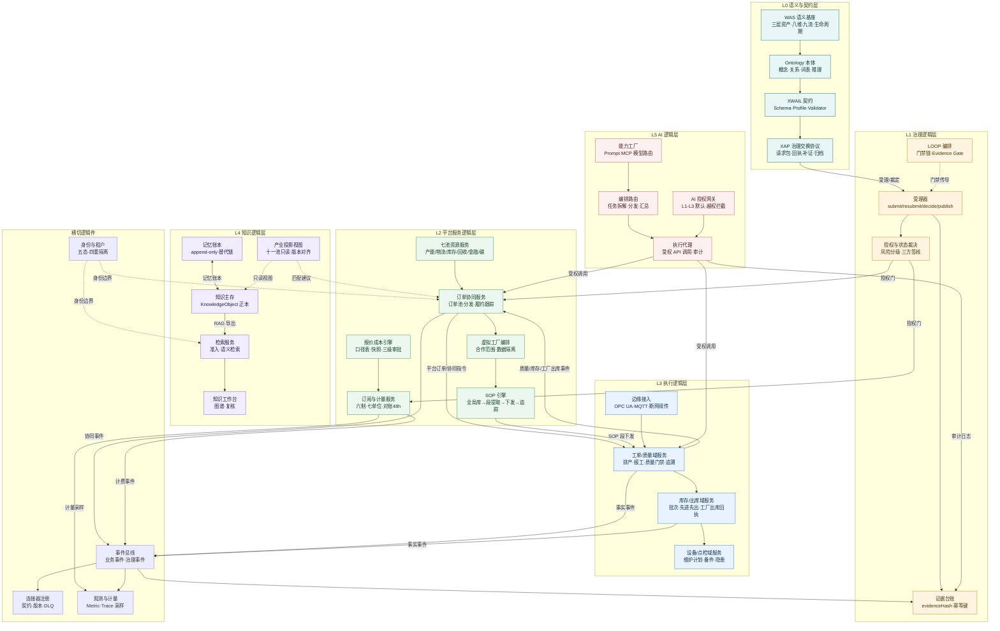

# GlobalCloud 项目群总体架构迭代分析

日期：2026-10-17　状态：controlled v1.0（2026-10-17 老卢确认转正 + 批准排期）
基线：`GlobalCloud项目群系统架构图.md` v1.0（controlled）· `GlobalCloud项目群架构图_20261017_v1.0.html`（蓝图图）
用途：对总体架构做合理性、可行性分析，给出优化方案，并新增「系统逻辑架构」视图（逻辑组件/接口/数据流，与物理项目映射解耦）。

---

## 1. 合理性分析

### 1.1 合理且应保留的架构决策（9 项）

| # | 决策 | 合理依据 |
|---|---|---|
| R1 | 事实源分层：GFIS=业务事实源、KDS=知识事实源、WAME=治理证据面 | 单厂连续运行不被云端依赖绑架；知识/业务/治理三类事实互不混写 |
| R2 | 状态族分离（资产生命周期/模型治理/推理可信/项目群验收） | 防止「候选」冒充「已发布」；四状态机可独立演进 |
| R3 | 门禁五条 + 不得自提/自审/自批/自发布 | 单一项目无法自闭环；AI 只能 candidate |
| R4 | 双总控（总体方案/实施方案） | 架构控制与实施控制分离，双向传导 |
| R5 | ICP 只读投影 + no_write_assertion | 产业控制建议与业务执行事实隔离，防第二主账 |
| R6 | AI 授权 L1-L5 阶梯 | AI 默认止步建议草案，安全关键控制不放开 |
| R7 | WAE 只统一界面层、不掌业务主账 | 入口统一不带来数据霸权 |
| R8 | XAP 统一治理交换（受理/回执/补证/归档状态机） | 跨项目治理交互有唯一通道与幂等语义 |
| R9 | 治理面（WAME）与运行面（PVAOS）共享契约不共享数据库 | 发布制品签名不可变，运行证据回流可验 |

### 1.2 结构性不合理点（8 项，均需优化）

| # | 问题 | 证据 | 影响 |
|---|---|---|---|
| I1 | **WAME 引擎面 not_implemented 是多链共同阻塞点** | WAS 总纲 §6；World 依赖引擎能力、CWME 依赖域实现、AaaS 计量依赖主账 | 运行时链 B、模型注册、计量三条链全部悬空 |
| I2 | **ICP 只读投影形成「投影的投影」** | ICP 自建 ResourcePoolProjection 读 KDS 十一池索引 | 副本漂移风险；产业建议可能基于过期投影 |
| I3 | **知识账本双入口** | KDS 仓 `_meta/hermes-memory-log.md` 由 GCMEM API/管理台写入，KDS 侧亦可触达 | 并发/幂等治理缺口（当前靠 doctor 巡检兜底） |
| I4 | **WAE 统一入口与 12+ 项目自带 UI 的并存策略未定义** | 各项目均有独立前端端口（WAME:4300、Brain:5175、PQC:3000…） | 收口过急打断现状，过缓则入口虚设 |
| I5 | **跨项目接口大面积 implementation_pending** | PVAOS↔WAME、AaaS↔GPC 场景包、Brain↔KDS 写回等均未落地 | 文档先行、运行脱节；治理交换、业务事件与知识写回的契约族未分别收敛 |
| I6 | **GFIS 云端 SaaS 汇总层与 GPC 七池职能重叠区未划线** | 跨厂库存/产能可见性两处都有描述 | 数据权威不唯一，同步方向模糊 |
| I7 | **CWME 双头归属** | 横切 B（域引擎实现）与 SpaceAI 旁挂域（场景运营应用）同时声称 CWME | 逻辑层/物理层映射不清，治理口径分裂 |
| I8 | **蓝图图节点重叠** | 图A 右列第 6 卡与「横切与旁挂」行重叠 410×66px；宽卡第 3 行溢出 | 图面不可读（本轮回传触发项） |

### 1.3 合理性结论

总体架构在「治理纪律」维度成熟度高（门禁/状态族/事实源分层均为工程界少见的高标准）；薄弱处在「运行时依赖收敛」与「接口落地」两个维度。架构骨架无需推翻，本轮以**优化而非重构**为原则。

---

## 2. 可行性分析

### 2.1 三档可行性

| 档 | 内容 | 依据 | 判定 |
|---|---|---|---|
| **短期可行（1-2 周）** | 蓝图图重叠修复；逻辑架构视图落地；XAP 受理 P1 闭环；SOP 池登记；GCMEM 已运行；GFIS 承接现代精工 OEM | 受理器 41 用例可运行；GCMEM v1.5.x 活跃 | ✅ 直接执行 |
| **中期可行（有前置）** | WAME 引擎 E1（主账+模型注册最小集）；GPC 平台对象模型 Phase 1；WAE 导航统一；PQC 二期；GFIS→GPC 事件合同 | 前置：World 线 A 引擎共建排期、XAP 契约扩展 | 🟡 需排期与人力 |
| **依赖外部/高风险** | 四账实测值；计费 realBilling；SpaceAI 真实设备接入；葛化投产 | 葛化投产=单一外部事件；计费实施≈5% | ⚑ 外部事件驱动 |

### 2.2 明确「不做」清单（防空转）

1. 零外部账号需求前，不建租户自助开通/编排脚本/语音通道（双轨路线已定）。
2. 引擎面未落地前，不宣称 World/CWME/AaaS 的运行能力。
3. 扩展池（生态/SOP/算法）未运行前，SKU-04/LOOP/计量字典只引用其设计态。
4. 不把页面可见、mock、dry-run 解释为业务闭环。

---

## 3. 架构优化方案（对应 I1-I8）

| # | 优化动作 | 落地项目 | 优先级 |
|---|---|---|---|
| O1 | **WAME 引擎分期**：E1=资产主账+模型注册最小集（Draft→Registered→Authorized），受理器→注册→发布→证据闭环先行；E2=事件/关系/计量；E3=运行底座全量。E1 由 World 线 A 共建（已立项口径） | WAME、World | P0 |
| O2 | **ICP 投影改读 KDS 只读视图**：十一池投影由 KDS 侧发布只读视图接口，ICP 不落副本；版本号对齐 24 字模型 | KDS、ICP | P1 |
| O3 | **知识账本唯一写入口**：GCMEM API 为唯一写路径，KDS 侧只读；增加写入幂等键与并发保护（账本已有替代链，补幂等契约） | GCMEM、KDS | P1 |
| O4 | **WAE 三步接入**：① host-kit 装配态登记（现状）→ ② AppSwitcher 统一导航（各项目 UI 保留）→ ③ 主流程逐步迁移。任何一步不夺业务主账 | WAE、各项目 | P2 |
| O5 | **治理接口收敛到 XAP 语义**：注册、授权、发布、证据和补证使用 XAP 请求包+回执；业务订单/工厂事件和知识查询分别采用业务事件与知识契约，不强制套用 XAP | WAME、XWAIL、GPCF | P1 |
| O6 | **GFIS→GPC 单向事件合同 v0.1**：库存、质量放行、工厂出库事件由 GFIS 单向发出；GPC 持跨厂读模型、运输与客户 POD；明确对象 ID、幂等、重放和证据来源 | GFIS、GPC | P1 |
| O7 | **CWME 归位**：逻辑层 CWME=域引擎实现（横切 B）；物理层 SpaceAI 桌面应用=其消费端之一。文档口径统一，中央台账同步 | GPCF、SpaceAI、World | P0 |
| O8 | **蓝图图面重构**：图A 重排消除重叠；新增图E 系统逻辑架构 | GPCF | P0（本轮） |

---

## 4. 系统逻辑架构（新增视图）

口径：逻辑视图只描述**逻辑组件与接口**，不绑定仓库；物理项目与逻辑组件为 N:1 映射（见 §4.2）。逻辑架构是 §3 优化的目标态描述，未落地项以 🔨 标注。

### 4.1 逻辑分层与接口图

### 4.2 逻辑组件 → 物理项目映射

| 逻辑组件 | 权威承载项目 | 消费/协同 | 状态 |
|---|---|---|---|
| WAS/Ontology/XWAIL/XAP | WAS世界资产体系、XWAIL | 全部项目（契约引用） | ✅/🟡 draft |
| 受理器/授权/证据台账 | WAME（平台面） | 全部项目 | 🟡 受理器可用 · 授权流程 partial |
| LOOP 编排 | GPCF | 全部项目 | ✅ 活跃 |
| 订单协同/七池/虚拟工厂/SOP 引擎 | GPC | PVAOS、GFIS | 🟡 Phase 0/1 |
| 订阅与计量 | AaaS | WAME、PVAOS | 🔨 计费≈5% |
| 报价成本引擎 | PQC | PVA 运营侧 | 🟡 工程验证通过 |
| 工单/库存/设备域服务 | GFIS | GPC、WAME | ✅ 96/100 |
| 边缘接入 | Edge/OT（随 GFIS 部署） | GFIS | 🟡 |
| 知识主存/检索/工作台 | KDS、Brain | 全部项目 | ✅ 95/100 |
| 记忆账本 | GCMEM | 四端 | ✅ active |
| 产业投影视图 | ICP（建议 O2 收敛到 KDS 只读视图） | GPC、GFIS、PVAOS | candidate |
| 能力工厂/编排路由/执行代理/AI 授权网关 | XiaoC、XGD、XiaoG、WAME | Brain、业务系统 | 🟡 |
| 身份与租户 | MMC（控制面）+ PVAOS（门户） | 全部项目 | 🟡 |
| 事件总线/连接器注册/观测 | 待建（三件待建口径） | 全部项目 | 🔨 |

### 4.3 逻辑接口清单（收敛目标）

| 接口 | 语义 | 载体 | 状态 |
|---|---|---|---|
| XAP-治理 | 注册/授权/发布/证据/补证 | XAP 包+回执 | 🟡 参考实现 |
| EVT-事实 | GFIS 工单/质量/库存/工厂出库事件；GPC 运输/客户 POD 事件 | 来源分离的事件合同 v0.1（O6） | 🔨 待建 |
| RAG-知识 | 知识准入检索导出 | KDS RAG 接口 | ✅ |
| SOP-下发 | SOP 段提取下发与执行追踪 | SOP 引擎 | 🟡 |
| MET-计量 | 计量采样+证据指针 | 七单位字典 | 🔨 采样待建 |
| PKG-绑定 | 服务包与模型版本绑定 | XWAIL 绑定校验 | ⚑ 校验器缺失（implementation_pending） |

---

## 5. 图面修订记录（本轮）

1. 图A 重叠修复：右列六卡与「横切与旁挂」行错位重排（原 410×66px 重叠），宽卡加高避免第 3 行溢出。
2. 新增图E「系统逻辑架构」蓝图页（本文件 §4 的蓝图化）。
3. 蓝图 HTML 版本升 v1.1，changelog 增加本轮修订说明。

## 5.1 裁定与排期（2026-10-17 老卢批准）

1. 本文 draft v0.1 → **controlled v1.0**（老卢确认）。
2. O1-O8 **按优先级排期执行**，GPCF Feature **F-025** 追踪 P0：
   - **P0（立即）**：O1 WAME 引擎 E1 分期规划（资产主账+模型注册最小集，World 线 A 共建）· O7 CWME 归位逻辑层口径统一传导 · O8 图面重叠修复（已完成）。
   - **P1（次批）**：O6 GFIS→GPC 单向事件合同 v0.1 · O5 治理接口收敛 XAP 语义 · O3 知识账本唯一写入口 · O2 ICP 投影改读 KDS 只读视图。
   - **P2（后续）**：O4 WAE 三步接入 · pending 接口清单收敛。
3. 各优化动作落地须按双总控传导机制回传项目群总体方案/实施方案。

## 6. 非声明边界

本文为受控分析基线：不声明任何系统已按 §3 优化落地（O8 除外）；逻辑架构为 O1-O8 的目标态描述；未经验证的事实保持 🔨/⚑ 标注。P1/P2 优化动作落地须按双总控传导机制回传项目群总体方案/实施方案后方可执行。
