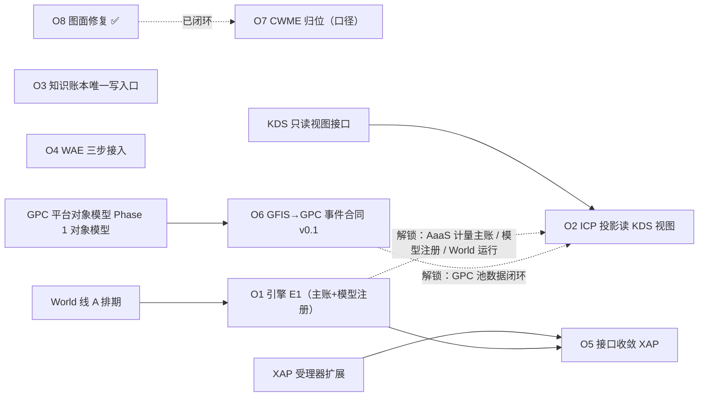
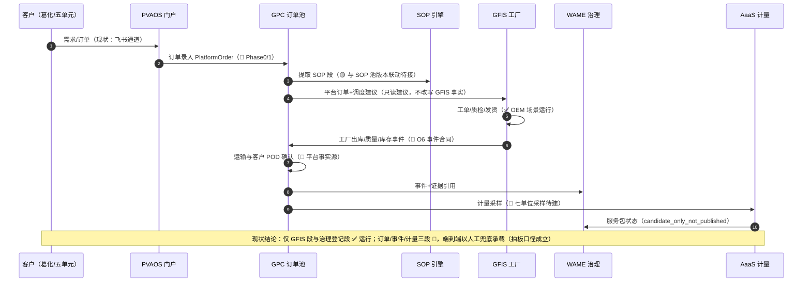
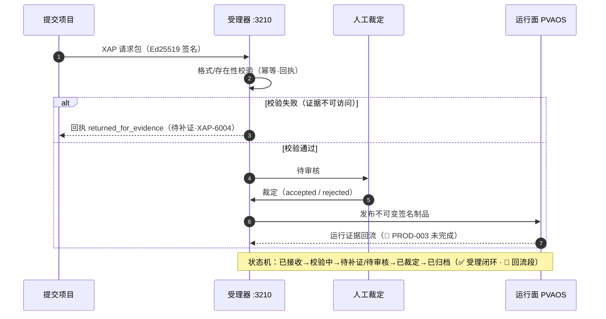

# GlobalCloud 项目群架构深化分析

日期：2026-10-17（初版）· 2026-10-18（24 仓复核 + 转正 + 外部评估交叉验证 v1.1）　状态：controlled v1.1（2026-10-18 老卢确认转正）
继承：`GlobalCloud项目群总体架构迭代分析` v1.0（controlled，2026-10-17）· `GlobalCloud项目群系统架构图` v1.0（controlled）
定位：分析层续篇。**不包含真实开发**——把迭代分析中的 O1-O8 深化为可决策、可排期、可走查的架构资产。

---

## 1. 关键架构决策 ADR 集（6 条）

> 格式：背景 → 决策 → 备选与取舍 → 后果。状态均为 `approved-in-analysis`（分析层批准，开发侧另行立项）。

### ADR-01 WAME 引擎面共建策略（对应 O1）

- **背景**：引擎面 not_implemented 同时阻塞 World 运行能力、CWME 域实现、AaaS 计量主账、模型注册四条链。
- **决策**：由 **World 线 A 一并规划设计**引擎侧（World README 既有口径），分三期：E1=资产主账+模型注册最小集（Draft→Registered→Authorized）→ E2=事件/关系/计量 → E3=运行底座全量；**受理→注册→发布→证据闭环先行**，不等待全量。
- **备选与取舍**：
  - (a) WAME 仓独立自建：职责最纯，但人力分散、与消费侧脱节；
  - (b) 引入第三方资产引擎：短期快，引入外部依赖与治理缝隙，违背「自研治理」基线；
  - (c) 冻结 World/CWME 等引擎：阻塞交付链，与最小闭环原则冲突。
- **后果**：E1 排期绑定 World 线 A；须防 World 反客为主——**治理裁决权始终归 WAME 与人工**（门禁五条兜底）。

### ADR-02 WAE 渐进收口（对应 O4）

- **背景**：WAE 是统一入口，但 12+ 项目已有自持 UI（WAME:4300、Brain:5175、PQC:3000、World:8720…）。
- **决策**：三步收口——① host-kit 装配态登记（现状）→ ② AppSwitcher 统一导航（各项目 UI 保留）→ ③ 主流程逐步迁移。**任何一步不夺业务主账**。
- **备选与取舍**：(a) 一次性强制收口：打断现状、迁移风险集中；(b) 永不强收：入口虚设、治理分散。
- **后果**：过渡期双入口并存，需 AppSwitcher 元数据治理（应用注册表 app-registry 承担）。

### ADR-03 ICP 投影位置（对应 O2）

- **背景**：ICP 自建 ResourcePoolProjection 读 KDS 十一池，形成「投影的投影」。
- **决策**：**十一池只读视图由 KDS 侧发布**，ICP 不落副本；投影版本号与 24 字模型对齐。
- **备选与取舍**：(a) 维持 ICP 自建副本：快，但漂移与过期建议风险；(b) ICP 并入 KDS：职责混淆，产业控制候选与知识主存混写。
- **后果**：KDS 新增只读视图接口面（新接口，需 RAG 准入同级别门禁）；ICP 查询延迟取决于视图刷新策略。

### ADR-04 GFIS↔GPC 数据权威（对应 O6）

- **背景**：跨厂库存/产能可见性在 GFIS 云端汇总层与 GPC 七池两处都有描述，权威未划线。
- **决策**：**库存、质量放行、工厂出库事件由 GFIS 单向发出**；GPC 建跨厂读模型并持平台订单、运输和客户 POD 事实，不反写 GFIS 主账；事件合同 v0.1 按事件来源先行（PlatformOrder/Shipment/POD 对象各有主责）。
- **备选与取舍**：(a) 双向同步：冲突裁决复杂、单厂自治被破坏；(b) GPC 直连工厂库：单厂连续运行依赖云端（违反宪法边界）。
- **后果**：GPC 池视图完整性依赖事件链（需 EVT 合同 + DLQ + 重放补偿）；断网续传由 Edge 承担。

### ADR-05 XAP 唯一受理通道（对应 O5）

- **背景**：跨项目接口大面积 implementation_pending，且形态各异。
- **决策**：**跨项目治理交互（注册/授权/发布/证据/补证）统一走 XAP 请求包+回执**（受理侧状态机：已接收→校验中→待补证/待审核→已裁定→已归档）；业务事件、设备遥测和知识查询使用各自契约，不套用 XAP；禁止项目间私设治理类 RPC。
- **备选与取舍**：(a) 点对点 API：快，但治理不可审计、越权难拦截。
- **后果**：XAP 成为治理单点 → 受理器可用性、幂等、重提（XAP-6004 补证）是关键工程基线（41 用例）。

### ADR-06 AI 授权边界形态

- **背景**：AI 服务流只出草案（L1-L3），但工具级授权尚未对象化。
- **决策**：**工具授权范围由 WAME 下发**、运行记录强制回流审计（XiaoG→WAME）、越权拦截在授权网关；L4 治理授权归 WAME 与人工，L5 安全关键控制 AI 不得接管。
- **备选与取舍**：(a) 模型级全局开关：粒度太粗，无法区分「查订单」与「改库存」。
- **后果**：每个 AI 工具需登记授权范围（Agent 工具权限目录待建，挂 WAME）。

---

## 2. O1-O8 依赖网络与关键路径

- **批次划分**：批 1（分析侧，无工程依赖）= O7、O8；批 2（契约侧）= O1、O3、O6（可并行）；批 3（视图侧）= O2、O4、O5（依赖批 2 产物）。
- **关键路径**：World 线 A 排期 → O1 引擎 E1 → O5 治理接口收敛 → 跨项目治理回流；O6 业务事件合同并行推进。
- **依赖红线**：O1 未完成前，不声明 World/CWME/AaaS 的运行能力（非声明边界）。

## 3. 质量属性分析

| 属性 | 架构手段 | 现状 |
|---|---|---|
| 一致性 | KDS canonical + 业务主账分层 + 状态族分离 + 「数字冲突以 KDS 为准」 | ✅ 基线；🔨 主数据分布表待落地（见蓝图图F） |
| 可演进性 | 契约版本化（XWAIL 1.1→1.2 迁移表）+ Profile 特化 + XAP 迁移/回滚 | 🟡 draft 迁移表在案 |
| 可用性 | 单厂 GFIS 本地连续运行不依赖云端（宪法级）；受理器幂等+补证重提 | ✅ GFIS；🟡 受理器 41 用例 |
| 安全 | 租户四重隔离 I1-I4 · 三级密钥 · 十道边界墙 · 写门禁默认关闭 | 🟡 信任面 80%；⚑ gcspaceai-backup 凭据待脱敏 |
| 性能 | 证据指针/计量采样而非全量复制；RAG 准入（canonical+E3+） | 🟡 采样系统 🔨 |
| 可审计 | Evidence Ledger + LOOP 回放 + append-only 记忆账本 | ✅ 运行；🔨 审计节点留存 |

优先级论证：**一致性 > 可审计 > 可用性 > 性能**。理由：这是治理主导的项目群——事实可信是第一价值，性能问题可用证据指针与读模型缓解，而一致性问题会腐蚀全部下游（建议、计量、出账）。

## 4. 端到端场景走查（断点定位）

### S1 订单交付链（武汉城市圈 SOP 场景）

客户订单 → GPC 订单池/虚拟工厂 → SOP 段下发 → GFIS 工单/质检/发货 → POD 签收 → PQC 回款 → AaaS 计量出账。

| 段 | 承载 | 状态 | 断点 |
|---|---|---|---|
| 订单录入/分发 | GPC PlatformOrder | 🔨 Phase 0/1 未运行 | 订单事实源暂以台账/人工承载 |
| SOP 段下发 | GPC SOP 引擎 | 🟡 | 与 SOP 池版本联动待接 |
| 工厂执行 | GFIS | ✅ OEM 场景运行 | 葛化自有工厂未投产 |
| 客户签收/POD | GPC 平台签收事实，引用 GFIS 出库回执 | 🟡/🔨 | `gcfis_pod_status` 是既有字段，不能单独作为客户签收权威；GPC POD 来源与争议机制待建（O6） |
| 回款 | PQC | 🟡 工程验证 | 业务验收未确认 |
| 计量出账 | AaaS | 🔨 | W9 人工兜底（拍板口径）成立 |

**结论**：端到端自动化不可行，人工兜底路径是当前唯一真实闭环——与拍板口径一致，架构不需要「强行自动化」。

### S2 知识查询与写回链（GKE-001）

用户 → Brain 检索 → KDS canonical（RAG 准入）→ 引用证据；AI 候选 → Studio 人工复核 → 按授权写回 KDS（经 MMC Gateway）。

| 断点 | 说明 |
|---|---|
| 写回契约 | Brain `authorization_boundary`：本地 action 不写 KDS，写入契约待授权 |
| 候选确认 | Studio 人工复核后写回，需 WAME 授权门（GKE-001 单一责任链已定） |

**结论**：读链 ✅ 运行；写链待 O3（唯一写入口）+ 授权契约。

### S3 XAP 治理受理链

项目提交 XAP 包 → 受理器校验（格式/存在性）→ 待补证/待审核 → 人工裁定 → 发布（不可变签名制品）→ 运行面导入（PVAOS）→ 运行证据回流。

| 断点 | 说明 |
|---|---|
| 真实回流 | PROD-003 未完成：事件总线/回流补偿仅本地回执 |
| 制品流转 | 治理面→运行面跨仓流转只到本地回执，签名制品分发待接 |

**结论**：受理闭环（提交→裁定→归档）✅ 参考实现可用；**回流段是治理闭环最后的断点**，O5 收敛时一并补。

### 4.1 关键时序走查（目标态 vs 现状）

时序走查结论：两条链的「末段缺口」高度一致——**事实产出段 ✅，跨系统流转段 🔨**。架构的当务之急不是新建系统，而是把 O6 事件合同与 XAP 回流段补上（对应批 2 排期）。

## 5. 风险矩阵

| # | 风险 | 概率 | 影响 | 缓解 | 归属 |
|---|---|---|---|---|---|
| R1 | 收入事实源缺失（葛化未投产→四账设计值） | 高 | 高 | 价值账纪律：设计值≠实测值；投产后稳 3 月再开分成 | AaaS |
| R2 | W9 出账 vs 计费系统赛跑 | 中 | 高 | 人工兜底出账（拍板）+ 计费最小闭环并行 | AaaS |
| R3 | 引擎 E1 拖期阻塞多链 | 中 | 高 | E1 最小集裁剪；受理闭环先行 | WAME/World |
| R4 | 知识账本并发损坏 | 低 | 高 | O3 唯一写入口 + 幂等键 + doctor 巡检 | GCMEM |
| R5 | 治理漂移（假就绪声明） | 中 | 高 | 门禁五条 + candidate_only + 四状态族分离 | GPCF/WAME |
| R6 | 单人单机单通道（老卢/主 Mac/飞书） | 中 | 中 | 升格演练 + 兜底预案（未落图，待补） | GPCF |
| R7 | 接口 pending 积压致双轨混乱 | 中 | 中 | O5 XAP 收敛 + pending 清单台账 | GPCF |
| R8 | 图面/文档多版本漂移 | 高 | 中 | 文档控制台账 + deprecation register（已运行） | GPCF |
| R9 | gcspaceai-backup 疑似凭据泄露 | 低 | 高 | 脱敏处置（SpaceAI STATUS 台账跟踪，待办） | SpaceAI |

## 6. 遗留问题清单（分析侧待核项汇总）

1. AaaS DoDAF 六项待核：预备池计数 12+ vs 7/9/8=24 自冲突 · 主体模板 10 vs T1-T14 · 门禁五条源列四条 · XAP 授权态 · WAS 版本双口径（1.1.0 vs 理论 v1.10）· Profile 0.1.0 候选待评审。
2. `validate_aaas_binding.py` 缺失 → implementation_pending 登记。
3. 对齐版路线图锚点「仓储发运」已被「工业绿链」替换 → 对齐版 §12 待回传修订。
4. Operational 双口径（拍板判定 vs 能力等级）待统一表述。
5. 物流/城市域的平台主体与运营三侧映射待确认。
6. WAE 过渡期双入口并存的 AppSwitcher 元数据治理规范待建。
7. 主 Mac/数据节点升格预案未落图（R6 缓解待补）。

## 7. 图面修订（蓝图 HTML v1.2）

新增：图F 数据架构视图（三层数据+主数据分布+同步机制）· 图G 部署拓扑视图（单厂本地/服务器/AI 节点/桌面域+演进带）。详见 `GlobalCloud项目群架构图_20261017_v1.0.html`（changelog ⑤）。

## 8. 项目架构健康度评分模型（v0.1 · 分析层）

用途：以统一五维给 24 仓做「架构健康度」快照，定位短板排序。**不构成任何状态提升依据**，缺证据维度给保守分并标 ⚑。

| 维度（各 20 分） | 判据 |
|---|---|
| 事实源唯一性 | 不建第二主账、写回过门禁、无越权写事实 |
| 门禁完备性 | Manifest/AGENTS/受控文档/状态纪律齐备 |
| 接口成熟度 | 跨项目契约落地 vs pending（XAP 收敛度） |
| 证据链完整性 | LOOP/Evidence Gate 可回放、真实证据非 mock |
| 文档受控度 | 入 register、状态如实、无漂移 |

**全量评分（24 仓，2026-10-18 复核口径；全部 A=直接证据）**：

| 仓 | 事实源 | 门禁 | 接口 | 证据 | 文档 | 合计 | 短板 |
|---|---|---|---|---|---|---|---|
| GFIS | 20 | 20 | 12 | 18 | 18 | 88 | 事件合同 🔨（O6） |
| KDS | 20 | 18 | 14 | 18 | 20 | 90 | 写入口 🟡（O3） |
| WAME | 20 | 18 | 14 | 14 | 18 | 84 | 引擎面/回流 🔨（O1/O5） |
| AaaS | 20 | 18 | 8 | 12 | 18 | 76 | 计费/绑定 ⚑🔨 |
| ICP | 20 | 18 | 12 | 12 | 18 | 80 | 投影副本（O2） |
| PQC | 20 | 18 | 14 | 14 | 14 | 80 | 业务验收未确认 |
| GPC | 18 | 18 | 8 | 10 | 16 | 70 | 平台对象模型 Phase 0/1 |
| World | 18 | 12 | 8 | 10 | 12 | 60 | 中央门禁 rework_required |
| WAS | 20 | 20 | 16 | 15 | 20 | 91 | P1-P3 骨架待落地 |
| XWAIL | 20 | 16 | 16 | 13 | 16 | 81 | V1.2 规则 PoC 待正式化 |
| AAAS | 20 | 16 | 8 | 15 | 18 | 77 | validate_aaas_binding ⚑ |
| WAE | 20 | 15 | 14 | 12 | 16 | 77 | 装配规范送审 · 无 AGENTS |
| GCMEM | 20 | 14 | 16 | 15 | 15 | 80 | 无 Manifest · 镜像 9-20 批未列 · 四端/夜挖待证据（§8.1） |
| Brain | 18 | 17 | 12 | 19 | 18 | 84 | 写回授权契约 |
| PKC | 18 | 17 | 12 | 14 | 14 | 75 | 经 MMC Gateway 写回未验收 |
| MMC | 20 | 20 | 16 | 19 | 18 | 93 | 能力目录对接范围待定 |
| XiaoC | 18 | 14 | 10 | 12 | 17 | 71 | UI 测试阻塞（历史口径） |
| XiaoG | 18 | 17 | 12 | 14 | 16 | 77 | 设备验证授权包待接 |
| XGD | 16 | 14 | 8 | 8 | 14 | 60 | not_started（首轮纳入口径） |
| SOP | 20 | 17 | 10 | 13 | 16 | 76 | 回写队列 candidate |
| Studio | 18 | 17 | 12 | 17 | 16 | 80 | LOOP 驱动无静态状态 |
| PVAOS | 18 | 17 | 8 | 11 | 16 | 70 | 跨项目接口 implementation_pending |
| SpaceAI | 18 | 16 | 12 | 15 | 14 | 75 | 业务验收未确认 |
| SpaceAIStudio | 16 | 16 | 8 | 13 | 14 | 67 | 待人工验收与三平台产物 |

**证据索引（16 仓复核取证 · 2026-10-18）**：

| 仓 | 取证要点 |
|---|---|
| WAS | `PROJECT_HARNESS_MANIFEST.md` status=controlled · AGENTS✓ · `okf/validators/validate_all.py` 13 项 PASS |
| XWAIL | Manifest✓ AGENTS✓ · 无 status 字段 · 1.2 规则 PoC + validator 全绿 · 无 `.harness/runs` |
| AAAS | Manifest✓ AGENTS✓ · lighthouse P01 校验证据（0 issue）· `validate_aaas_binding.py` 缺失 ⚑ |
| WAE | Manifest✓ · **无 AGENTS.md** · 写门禁默认关闭已实现 · 装配规范送审中 |
| GCMEM | **无 PROJECT_HARNESS_MANIFEST.md**（治理缺口）· AGENTS✓ · 本会话实测回归 82/82 · doctor healthy=true / 账本 71 条 · GPCF 镜像已完成列表止于第八批（9-20 批未列，见 §8.1） |
| Brain | Manifest✓ AGENTS✓ · `.harness/runs` 83 条 · authorization_boundary 显式 |
| PKC | Manifest✓ AGENTS✓ · `.harness/runs` 4 条 · in_progress |
| MMC | Manifest✓ AGENTS✓ · `.harness/runs` 22 条 · Ph1 12/12 evidence |
| XiaoC | Manifest✓ AGENTS✓ · `tests/` 在 · UI 测试超时阻塞（历史 78/100） |
| XiaoG | Manifest✓ AGENTS✓ · `tests/` 在 · ready_for_review |
| XGD | Manifest✓ AGENTS✓ · 状态 not_started（首轮纳入口径） |
| SOP | Manifest✓ AGENTS✓ · `.harness/runs` 1 条 · P1 最小基线 |
| Studio | Manifest✓ AGENTS✓ · `.harness/runs` 19 条 · `tests/` 在 |
| PVAOS | Manifest✓ AGENTS✓ · D4 发布准入治理分支 · 跨项目接口 pending |
| SpaceAI | Manifest✓ AGENTS✓ · `.harness/runs` 3 条 · 中央 STATUS v1.1 已修正 |
| SpaceAIStudio | Manifest✓ AGENTS✓ · status=controlled · `.harness/runs` 1 条 · P0-P5 已交付待验收 |

**解读**：全群 24 仓平均 ≈ **78**/100（77.6）。维度均值——事实源 18.9、门禁 16.8、接口 **11.7（最低维）**、证据 13.9、文档 16.3。短板分布：接口成熟度（全群均值 ≈ 11.7/20）与证据链完整性（≈ 13.9）仍是主短板。**尾部三仓（World 60、XGD 60、SpaceAIStudio 67）为「纳管新/首轮纳入」或中央门禁 rework 状态，属治理跟进问题而非架构缺陷**；中段（70-80）主要卡在跨项目接口与证据。提升杠杆仍指向批 2（O1/O3/O6）+ 批 3（O2/O4/O5），与 §4.1 时序结论一致。

**本轮复核修正（7 处）**：GCMEM 87→80（-7，外部评估交叉核验，见 §8.1）· XWAIL 81（-3，无状态字段）· AAAS 77（-1，绑定校验缺失）· WAE 77（-3，无 AGENTS）· PKC 75（+5，harness 证据）· XGD 60（+2，Manifest/AGENTS 已补）。

**评分纪律**：① 分值只作分析快照，不声明验收状态；② 全部 24 仓已按直接文件证据复核（2026-10-18），证据索引见上；③ 每仓评分变化须附证据引用；④ 本模型与 Harness 评分（如 GFIS 96/100）维度不同，不可互比；⑤ 外部评估作为证据源时须**逐项复核**：未复现项标注「未复现（快照差异）」且不据此扣分，部分成立项按复核结果折算。

### 8.1 外部评估交叉验证（Codex · GCMEM · 2026-10-18）

老卢转交 Codex 对 GCMEM 的评估（综合 78/100，中等置信度；建议保持 `partial`；不构成 accepted/integrated/production_ready）。**本会话逐项复核结果**：

| # | Codex 评估项 | 复核方法 | 结果 |
|---|---|---|---|
| 1 | 回归 81/82，`tests/test_gcmem_admin.py:66` 把 `2026-10-18` 固定为未来起始日期，测试恰在 10-18 运行失败 | 读当前测试源码 + 全量跑测 | **✗ 未复现**：测试已用**相对日期**（条目日期 +1 天）；本会话实测 **82 passed**（4.84s） |
| 2 | README 仍写 58/58 旧基线 | 读 `README.md` | **✗ 未复现**：README 已写 **82/82** |
| 3 | 本仓第九至第二十批状态未回传 GPCF 镜像 | 对比本地 `docs/STATUS.md`（已到第二十批）与 `GPCF projects/gcmem/STATUS.md` | **🟡 部分成立**：镜像 2026-10-18 已含纳管要点与 82/82、partial；但「已完成」列表止于第八批，9-20 批（管理台 M1-M5、打磨、风格）未列 |
| 4 | 缺少管理台浏览器自动化验证 | 检索仓库证据 | **✓ 成立** |
| 5 | 四端新会话联测、连续三日夜挖验收、容器侧迁移无验证证据 | 对照镜像自身「待证据」声明 | **✓ 成立**（镜像明载） |
| 6 | 运行证据：/health ok、检索 3 条、doctor healthy、账本 71 条、管理台页面可加载 | 本会话直接调用 API | **✓ 复现**（检索按查询词条数不同，属正常） |

**结论与联动**：
1. Codex 的总体判断（本机可用闭环、保持 partial、不构成验收）**与项目群台账一致**，本会话无反驳。
2. 其两处具体指控（测试失败、README 旧基线）**基于陈旧快照**——当前工作区已是 82/82 全绿。**外部评估须注明评估快照版本/提交哈希**，否则单条指控不可直接采信（已写入评分纪律⑤）。
3. 成立项（镜像批次滞后、缺浏览器自动化、四端/夜挖待证据）支撑 GCMEM「治理与交付」短板判断；据此 GCMEM 评分 87→80（证据 19→15、文档 18→15）。
4. 行动项（GCMEM 治理侧，本轮不执行开发）：① 镜像补录 9-20 批要点；② 管理台关键浏览器流程验证；③ 四端联测与连续三日夜挖验收补证；④ README 与 manifest 缺口（无 Manifest）补建。

## 9. 非声明边界

本文为分析层资产：ADR 均为 `approved-in-analysis`，不含开发执行；不声明任何系统已按 ADR 落地；场景走查结论不改变各项目 Manifest/STATUS 台账中的状态口径。
