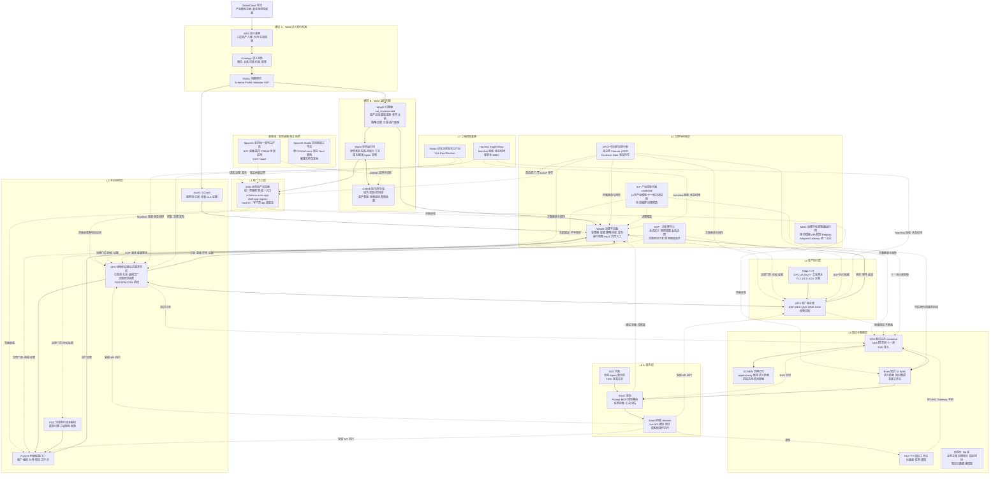
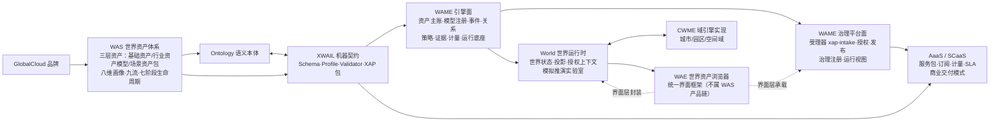
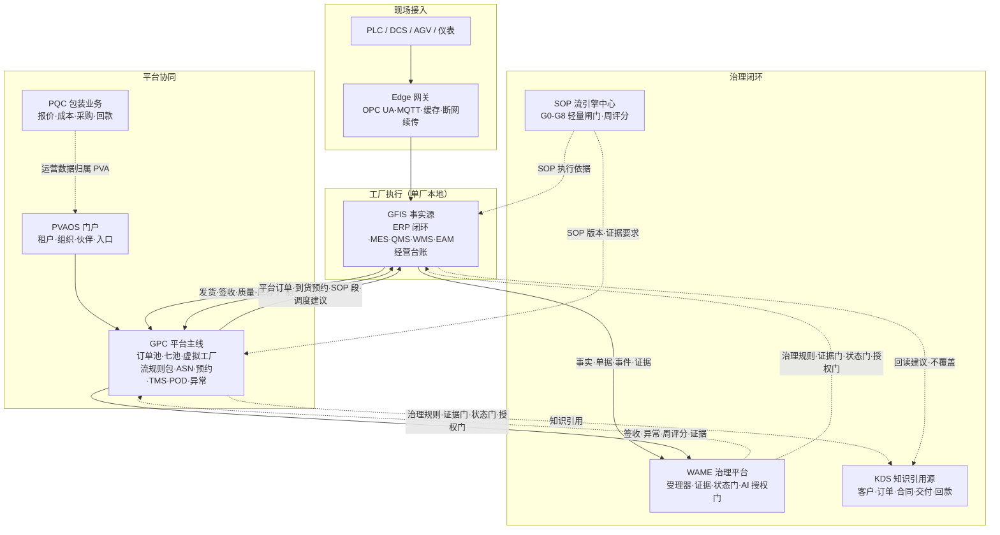
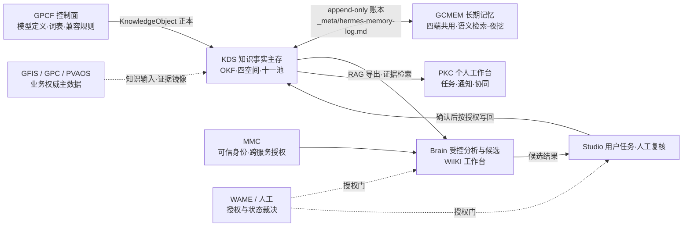
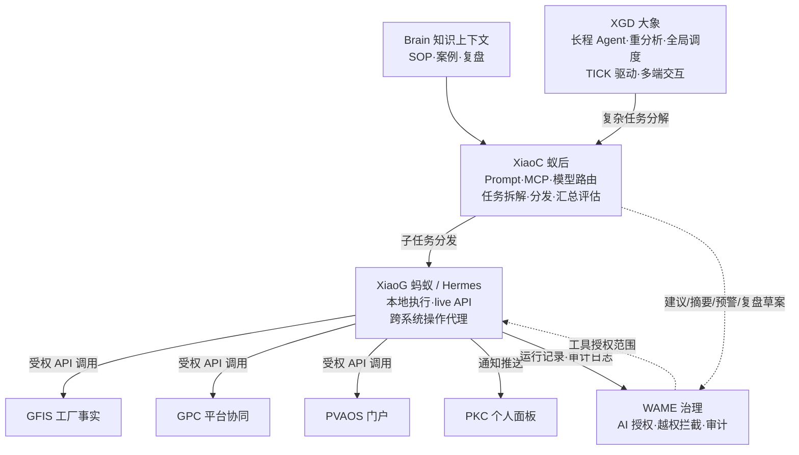
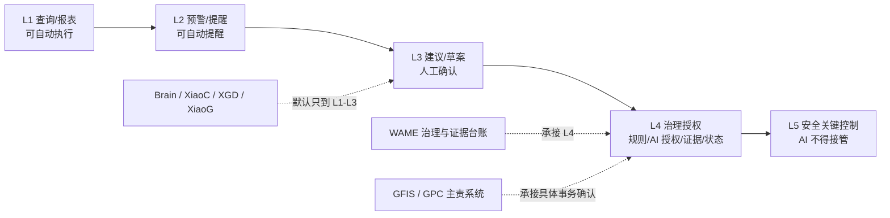
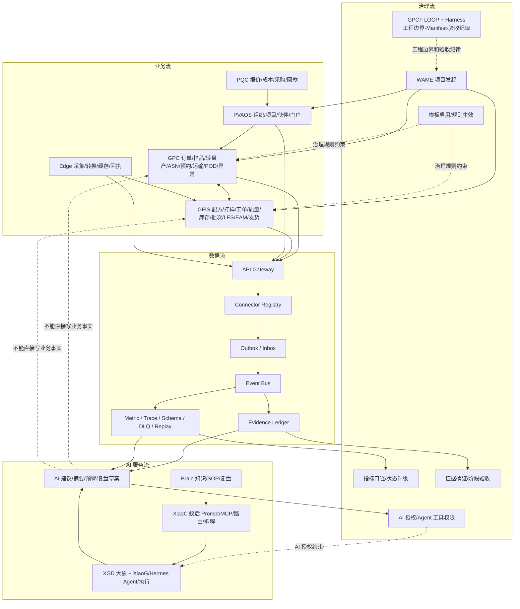

# GlobalCloud 项目群系统架构图

日期：2026-10-17　状态：controlled v1.0（2026-10-17 老卢审阅确认转正）
口径：覆盖项目群当前纳入的 **23 个纳管项目**（加 GPCF 治理仓共 24 个仓库；2026-10-16 口径，含 2026-10-10 新增 PQC/SpaceAI/SpaceAIStudio、2026-10-12 新增 WAE、2026-10-16 新增 World 与 GCMEM；`GlobalCloud 项目群总体方案` 的 related_projects 与 §2 清单在 WAE/World 上存在口径差异，本图以 GPCF `projects/` 目录实况为准），继承 `GlobalCloud 项目群总体方案` 与 `GlobalCloud 项目群实施方案` 双总控，吸收 2026-10-12 WAS 命名修订（WAME 合并、WAE 移交）与 2026-10-16 第九流「场景流」裁定。

本文是 2026-06-07 版项目群架构图（`GlobalCloud智慧工厂项目群架构图.md`、`GlobalCloud绿色供应链体系最新架构图.md`）的**全量完成形态**：原图只覆盖 11 个项目，本文补入 WAS 语义契约体系、WAS 运行时链（WAME 引擎/World/CWME/WAE）、知识工程链（KDS/GCMEM/Brain/PKC）、产业控制平面（ICP）、包装业务（PQC）与安防桌面域（SpaceAI/SpaceAIStudio）。

## 1. 分层模型与横切面

| 层 | 名称 | 项目 | 一句话职责 |
|---|---|---|---|
| L0 | 品牌与宪法 | GlobalCloud 宪法（KDS 保管正本、ICP 主责产业领域、GPCF 传导、WAME/人工裁决） | 最高规范性权威 |
| L1 | 统一入口层 | WAE | 统一界面框架与统一入口，只统一界面层，不掌业务主账 |
| L2 | 治理与授权层 | WAME（平台面）、GPCF、MMC、SOP（流引擎中心）、ICP | 治理、证据、授权、状态裁决与项目群控制 |
| L3 | 平台协同层 | GPC、PVAOS、PQC、AaaS/SCaaS | 跨组织协同、生态入口、商业交付与包装运营 |
| L4 | 生产执行层 | GFIS、Edge/OT | 单厂事实源与现场接入 |
| L5 | 知识与数据层 | KDS、GCMEM、Brain、PKC、结构化 DB 域 | 知识主存、长期记忆、知识 UI 与结构化数据 |
| L6 | AI 能力层 | XiaoC（蚁后）、XGD（大象）、XiaoG（蚂蚁/Hermes） | AI 能力生产、编排路由与受权执行 |
| L7 | 工程研发底座 | Studio、Harness Engineering（规范仓 MMC） | 研发、治理、发布与验收纪律 |
| — | 横切面 A | WAS/Ontology/XWAIL | 语义契约体系：定义体系 → 定义语义 → 定义契约 |
| — | 横切面 B | WAME（引擎面）、World、CWME | WAS 运行时链：引擎 → 世界运行时 → 域实现 |
| — | 横切面 C | 四流（治理流/业务流/数据流/AI 服务流） | 跨层交互约束模型 |
| — | 旁挂域 | SpaceAI、SpaceAIStudio | 安防桌面域：统一重构工作区（BFF/桌面/插件）+ 空间智能工作台，独立纳管，partial |

## 2. 主图：项目群全景系统架构图

> 可视化形态：[GlobalCloud项目群架构图_20261017_v1.0.html](./GlobalCloud项目群架构图_20261017_v1.0.html)（蓝图风拍板图，结构对标 AaaS_项目群架构图_20261017_v1.0.html；本文件 mermaid 图为其规范源）。



## 3. 图2：WAS 世界资产产品链与运行时链



WAS 产品链口径（`GlobalCloud世界资产体系正式命名与产品系统架构总纲`）：

```text
WAS 定义体系 → Ontology 定义语义 → XWAIL 定义契约
→ WAME 负责运行、治理、发布和业务入口 → AaaS/SCaaS 服务化运营资产世界
```

`WAE` 不属于 WAS 产品链，是项目群级统一界面框架。

## 4. 图3：供应链业务流与治理闭环



读图口径：GPC 负责平台协同、GFIS 负责工厂执行、WAME 负责治理约束、PVAOS 负责生态入口、Edge 负责现场接入；PQC 是 PVA 运营侧包装报价成本业务系统，不替代 KDS 主存、GFIS 工厂执行或 WAME 治理。

## 5. 图4：知识工程链 GKE-001



GKE-001 单一责任链：GPCF 定义 → KDS 主存 → Brain 消费 → MMC 调用 → WAME/人工授权。任何系统不得建立平行资料、证据、审计或长期记忆主账；任何 AI 结果在确认前只能是 `candidate`。当前工程状态固定为 `active / partial / not_complete`。

## 6. 图5：AI 三层 Agent 体系与授权边界





## 7. 图6：四流交互总图



四流口径：治理流约束业务流，不替代业务流；业务流产生事实和事件，不把 WAME 作为业务主账；数据流承载跨系统事实、证据、指标和追踪，不共享业务数据库；AI 服务流消费数据流、受治理流授权，输出建议草案，不写业务事实。

## 8. 项目-架构角色映射矩阵（23 纳管项目 + GPCF）

| # | 项目 | 架构层 | 主责 | 关键模块 | 对外数据流 | 就绪度（2026-10-17 口径） |
|---|---|---|---|---|---|---|
| 1 | WAS | 横切 A·语义基座 | 总体语义、架构与治理基线 | 三层资产·八维·九流·生命周期；OKF 契约层 + 11 validator | 读 KDS/GPCF；输出语义边界 → XWAIL/WAME/RAG | controlled，治理准入中；P0 落地，P1-P3 骨架 |
| 2 | XWAIL | 横切 A·契约 | 机器建模语言、契约、验证 | Schema·Profile·Validator·XAP 包·CLI 校核 | 读 WAS/Ontology；契约 → WAME 受理器/AAAS/Studio | draft/in_progress；V1.2 规则 PoC |
| 3 | AAAS | L3·商业交付 | 资产服务化、计量、SLA、证据要求 | ServicePackage·Metering·SLA/SLO·EvidenceRequirement·商业状态机 | 读 XWAIL/WAME 状态；服务包 → WAME 治理入口/SCaaS | baseline；服务包定义与样例 |
| 4 | WAME | L2 平台面 + 横切 B 引擎面 | 资产主账、运行引擎、治理执行、授权发布 | 受理器 xap-intake·主账·模型注册状态机·事件·关系·策略·证据·计量·Agent Desktop | 读 WAS/XWAIL/各业务只读；发布签名制品 → PVAOS | 引擎面 not_implemented；平台面 partial（受理器参考实现可用） |
| 5 | WAE | L1·统一入口 | 项目群统一界面框架与入口 | ui-tokens·ui-kit·app-registry·app-shell·host-kit 写门禁/idp/装配态 | 界面承载各项目；写门禁默认关闭 | in_progress；框架实施中 |
| 6 | GFIS | L4·工厂事实源 | 单厂生产/质量/仓储/设备/台账第一执行主体 | ERP 闭环·MES·QMS·WMS·EAM·云端 SaaS 汇总层 | → GPC 产能/库存/发货/签收；→ WAME 事实证据；→ KDS 回读建议 | ready_for_human_acceptance（96/100） |
| 7 | GPC | L3·平台主线 | 绿色供应链公共服务与协同 | 七池·虚拟工厂·流规则包消费·GPC 平台对象模型（PlatformOrder/Shipment/POD/ExceptionCase）·工厂适配器 | ↔ GFIS 订单/事件；→ PVAOS；→ WAME 事件证据 | ready_for_review；平台对象模型 Phase 0/1 |
| 8 | PVAOS | L3·生态入口 | 价值联盟门户与运营底座 | 门户·租户/组织/权限·伙伴·项目空间·工作流·PVAAI | ← GPC/GFIS/WAME 展示；→ AaaS 订阅计量 | ready_for_review；跨项目接口 implementation_pending |
| 9 | PQC | L3·包装运营 | 报价成本、采购、订单回款 | 统一口径表·成本引擎·参数审批·报价快照·三级审批·9 表 | ← KDS 案例只读；→ PVA 运营侧 | partial；工程验证通过，业务验收未确认 |
| 10 | KDS | L5·知识主存 | 知识事实主存与证据镜像（canonical） | OKF·四空间·十一池·SPACE_REGISTRY·可信治理内核 | ← GPCF 文档镜像；→ Brain/XiaoC RAG；← GCMEM 账本；← MMC Gateway（PKC/Brain 授权写回） | ready_for_human_acceptance（95/100） |
| 11 | GCMEM | L5·长期记忆 | 跨会话长期记忆（替代 mem0） | gcmem 核心库·MCP server·REST API 19090·管理台·夜挖 | ↔ KDS 唯一账本；四端（Hermes/Codex/Reasonix/DSH）共用 | active；v1.5.x |
| 12 | Brain | L5·知识 UI | 知识治理、语义检索、智能分析 UI | WiIKI 工作台·知识图谱·gbrain 检索（pgvector/Ollama）·面板契约 | ← KDS canonical；→ WAME/GPCF 门禁状态 | ready_for_review；authorization_boundary |
| 13 | PKC | L5·个人工作台 | 个人知识、任务与协同 | 仪表盘·任务·AgentRuns·Ask；SDK kds-client/mmc-llm | ← KDS personal 空间；写经 MMC Gateway 回 KDS | in_progress |
| 14 | MMC | L2·治理模板 + 控制面运行时 | 治理模板、模型管理与复用控制、API/模型注册 | 规范/模板/验收清单·openspec；控制面运行时 Gateway·API Registry·LLM Registry·PermissionGuard（FastAPI :8000）·统一 SDK | → 全项目下发规范/注册表/SDK；Brain/PKC 经 MMC Gateway 调 KDS | complete（Ph1，12/12 evidence） |
| 15 | XiaoC | L6·蚁后 | AI 能力生产、模型路由、任务拆解 | Prompt 工程·MCP·模型路由·Agent 模板·l4 编排 | ← Brain 知识；→ XiaoG 分发；→ WAME 草案 | partial（历史口径 78/100） |
| 16 | XGD | L6·大象 | 长程 Agent、重分析、多端交互 | TICK 主循环·双层思考·记忆系统（SQLite+向量）·焦点栈·Brain UI | → XiaoC 任务分解；→ WAME 建议草案 | not_started（2026-06-10 首轮纳入口径） |
| 17 | XiaoG | L6·蚂蚁 | 轻量执行、live API、通知、审计 | Hermes Studio：Vue3 控制台·Koa BFF·Electron·八平台渠道·Cron/语音 | 受权执行 → GFIS/GPC/PVAOS/PKC；→ WAME 审计 | ready_for_review |
| 18 | SOP | L2·流引擎中心 | 项目群唯一流引擎：全流（业务/开发）定义、规则装配、会话治理、流规则包下发 | schemas·sop/matrix·scripts 基线·会话收口·flow-registry（规划中） | ← KDS 唯一事实源；→ GPC/GFIS 下发流规则包；→ WAME/MMC/GPCF 证据 | P1 最小可运行基线，流引擎中心升级中（2026-10-17 裁定） |
| 19 | GPCF | L2·项目群治理 | 治理、文档、证据、门禁、LOOP 编排 | 双总控·features 体系·Evidence Gate·LOOP·09-status 台账 | → KDS 开发空间镜像；→ 各项目方案传导 | 活跃；F-001~F-024 |
| 20 | ICP | L2·产业控制 | 24 字产业模型、场景编排、决策候选 | IndustryModel·ResourcePoolProjection·ScenarioPackage·ControlDecisionCandidate·FastAPI | ← KDS 十一池只读；→ SOP/WAME/GPCF；→ GPC/GFIS/PVAOS 建议 | candidate / partial / human_required |
| 21 | SpaceAI | 旁挂域 | 安防监控平台统一重构 + CWME 场景运营应用 | apps/desktop（Tauri2+Vue3）·apps/server（Koa BFF·SSE）·packages/protocol（52 端点）·domain（32 模型）·plugin-sdk·plugins（设备/报警/巡更/门禁）·mobile-shell·apps/city-model | ↔ World（CWME 空间域）；BFF 注册 MMC 能力目录；契约归 XWAIL；ONVIF/RTSP/GB28181 设备接入 | partial/in_progress（BFF :39010 运行；业务验收未确认） |
| 22 | SpaceAIStudio | 旁挂域 | 空间智能工作台（与 Studio 平行，不合并） | 遗留 C# WinForms 宿主（12 模块）；重构 apps/desktop（Vue3+Tauri2+Cesium 三维 GIS） | 独立边界；与 SpaceAI/Studio 互不写入 | partial（registered；P0-P5 已交付，待人工验收） |
| 23 | World | 横切 B·世界运行时 | 世界状态、投影、授权上下文、模拟推演 | 世界模型投影·组织与 Agent·动态授权上下文·模拟实验室·统一工作台 | ← WAME 引擎能力；← KDS 事实；→ WAE 封装；↔ CWME | partial；中央文档门禁 rework_required |
| 24 | Studio | L7·工程研发底座 | 研发、治理和发布工作台（Hermes Web UI 形态） | Vue3 client（:8649）·Koa server（:8647）·Electron·features 管理·kds-sync LOOP 门禁 | 读 KDS（真实写需显式授权）；LOOP 证据经 WAME/GPCF 门禁；gcworld 模块 2026-10-17 已迁出至 World | LOOP 驱动，无静态状态 |

> 未纳入项目群 23 项目清单的仓：`GlobalCloud FireQuote`（消防定额测算平台，独立业务 MVP；GPCF `config/project-group-projects.yaml` 与 `projects/` 均无其条目，仅自管本地 Manifest）、`GlobalCloud SpaceAI Platform`（与 SpaceAI 同远端 GCSpaceAI 的统一重构主工作区，即 registry `spaceai` 条目承载地）、`GlobalCloud Studio-release0`（Studio 旧发行基线）、`_worktree-archive-20261012`（历史 worktree 归档），不进入本图主结构。

## 9. 读图口径与不越权声明

1. **一个总控体系**：项目群总体方案 + 项目群实施方案为双主控，所有项目方案必须继承并回传。
2. **WAS 语义契约体系是横切面**：不为任一业务层提供事实源；GFIS/KDS/十一池写回必须先过 WAS 语义与 WAME 门禁。
3. **WAME 是治理与授权平面**：不承办工单、质量、库存、发货、签收等具体事务审批；治理面（WAME）与运行面（PVAOS）共享契约不共享数据库。
4. **KDS 是唯一知识事实源**：Brain 是 UI，GCMEM 是记忆账本，均不建立第二主账；跨空间默认引用或脱敏投影。
5. **AI 只到 L1-L3**：AI 服务流只能生成建议、摘要、预警和复盘草案，不能直接写业务事实或正式知识版本；L4 治理授权归 WAME 与人工，L5 安全关键控制 AI 不得接管。
6. **ICP 固定 candidate/partial/human_required**：不拥有业务事实写入权、治理批准权或生产执行权。
7. **WAE 只统一界面层**：不接管任何项目的业务主账、治理裁决权或事实源；写门禁默认关闭。
8. **非声明边界**：本文不声明任一系统已实现、已集成、已交付或已验收；不声明 XWAIL/WAME/WAE 达到 `production_ready`；不声明真实业务闭环、客户验收或商业上线完成。未经人工确认，不得声明 `accepted`、`integrated`、`production_ready` 或 `customer_accepted`。

## 10. 承接关系与裁定记录

| 既有文档 | 关系 |
|---|---|
| `GlobalCloud智慧工厂项目群架构图.md`（2026-06-07，11 项目） | 已由本文承接，登记为历史基线（superseded；2026-10-17 老卢裁定） |
| `GlobalCloud绿色供应链体系最新架构图.md`（2026-06-07） | 已由本文承接，登记为历史基线（superseded；2026-10-17 老卢裁定） |
| `GlobalCloud世界资产体系正式命名与产品系统架构总纲.md`（2026-10-12） | 本文图2 为其完整展开 |
| `GlobalCloud体系最小闭环与三阶段激活深度总表.md` | 分层与激活深度口径来源 |

裁定记录（2026-10-17，老卢「全部同意」）：

1. 旧两版项目群架构图登记为历史基线、由本文承接——**已执行**：`09-status/document-deprecation-register.md` 登记，两份旧文档 frontmatter `status=archive`、`superseded_by` 指向本文，文档控制总台账与目录清单同步为 archive。
2. SpaceAI 中央台账——**核实已闭环**：`projects/spaceai/STATUS.md` v1.1（2026-10-16）已修正为「主项目 = SpaceAI Platform；本目录为 CWME 归档与本地应用区」，与本文图口径一致，无需再改；`/tmp/gcspaceai-backup` 疑似凭据脱敏事项由该 STATUS 台账继续跟踪。
3. 本文 status：draft v0.1 → **controlled v1.0**（2026-10-17 老卢确认）。
