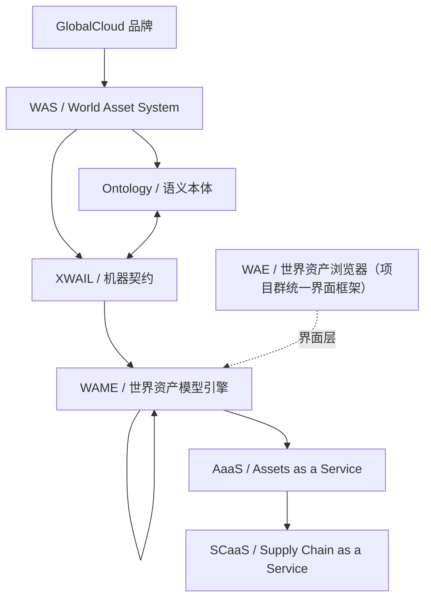

# GlobalCloud世界资产体系正式命名与产品系统架构总纲

日期：2026-10-12（命名修订版）　状态：controlled v1.1
定位：项目群**跨项目架构上位件**。定义 WAS 世界资产体系的正式命名、产品链、系统边界与门禁归属，供各项目方案继承。
继承来源：`WAS世界资产体系总体方案`、`WAS:docs/GlobalCloud-WAS总体方案V1.2-GPCF统一重构版.md`（v1.2.1-draft）。

## 1. 正式命名

| 名称 | 英文 | 中文 | 定位 |
|---|---|---|---|
| GlobalCloud | GlobalCloud | GlobalCloud | 品牌 |
| WAS | World Asset System | 世界资产体系 | GlobalCloud 品牌下的产品体系总称 |
| Ontology | Ontology | 语义本体 | WAS 的语义知识层（概念、关系、词表、约束、推理规则） |
| XWAIL | eXtensible World Asset Information Language | 可扩展世界资产信息建模语言 | WAS 的主规范建模语言与机器契约 |
| **WAME** | World Asset Model Engine | **世界资产模型引擎** | WAS 产品链的**运行引擎 + 治理平台**：资产主账、模型注册、事件、关系、策略、证据、计量、运行底座；治理、注册、授权、发布和业务入口（2026-10-12 由「原 WAE 引擎」与「原 WAES」合并为一） |
| AaaS | Assets as a Service | 资产即服务 | WAS 的商业交付模式与产品族 |
| SCaaS | Supply Chain as a Service | 供应链即服务 | AaaS 在供应链行业的行业化架构 |
| **WAE** | World Asset Explorer | **世界资产浏览器** | GlobalCloud **项目群统一界面框架与统一入口**（2026-10-12 立项 `WAS-WAE-BROWSER`） |

### 1.1 命名变更记录（2026-10-12，老卢裁定）

- 原「WAE = World Asset Engine·世界资产引擎」→ 更名为 **WAME**（World Asset Model Engine·世界资产模型引擎）。
- 原「WAES」（曾称世界资产浏览器）与上述引擎**合并为同一系统 WAME**；`WAES` 缩写**停用**。
- 「世界资产浏览器 / WAE」名移交新立项项目（GlobalCloud 项目群统一界面框架）。
- **传导范围**：WAS / KDS / GPCF / WAES 四仓的 **Markdown 命名与展示口径已同步**（2026-10-12）。
- **保持原样（另立专项）**：代码/契约标识符 `waesGateRefs`、`waesGateInputs`、包名 `@waes/app`、仓目录名 `GlobalCloud WAES`、文档文件名 `*WAES*.md`。

## 2. 产品链

```text
WAS     定义体系。
Ontology 定义语义。
XWAIL   定义契约。
WAME    负责运行、治理、发布和业务入口（运行引擎 + 治理平台）。
AaaS / SCaaS 服务化运营资产世界。
```

`WAE`（世界资产浏览器）**不属于 WAS 产品链**——它是项目群级统一界面框架，以界面层方式承载各项目入口。

## 3. 产品系统架构



## 4. 系统边界

| 系统对象 | 主项目 | 权威范围 |
|---|---|---|
| WAS | WAS世界资产体系 | 理论、标准、总体规划、术语基线、三层资产/八维/八流/生命周期/治理原则 |
| XWAIL | GlobalCloud XWAIL | Schema、Profile、Validator、Templates、Examples、Migration、Conformance Test |
| WAME | GlobalCloud WAME | 运行引擎 + 治理平台：资产主账、模型注册、事件、关系、策略、证据、计量、运行底座；治理、注册、授权、发布、运行视图与 AaaS/SCaaS 治理入口 |
| WAE | GlobalCloud WAE（`WAS-WAE-BROWSER`） | 项目群统一界面框架与统一入口；只统一界面层，不掌业务主账 |
| AaaS/SCaaS | GlobalCloud AaaS | 服务包、订阅、商业交付与通用订阅治理 |
| KDS | GlobalCloud KDS | 知识事实主存与证据镜像；不替代业务事实源 |

跨系统默认引用或脱敏投影；任何状态提升、写回、发布或商业授权仍需对应策略与人工授权。

## 5. 门禁与不越权

1. 未经人工确认，不得声明 `accepted`、`integrated`、`production_ready` 或 `customer_accepted`。
2. 授权与状态裁决归 WAME 与人工；单一项目不得完成自提、自审、自批、自发布闭环。
3. AI 结果在确认前只能是 `candidate`；Schema 校验或 AI 分类不能生成授权。
4. WAE 只统一界面层，不得接管任何项目的业务主账、治理裁决权或事实源。

## 6. 实现现状（反推对账，2026-10-12）

| 对象 | 就绪度 | 证据来源 |
|---|---|---|
| WAS 命名与语义基线 | ✅ established | `WAS:docs/GlobalCloud-WAS总体方案V1.2-GPCF统一重构版.md` v1.2.1-draft |
| XWAIL 契约 | 🟡 draft / partial | `WAS:okf/validators/validate_all.py` 13 项 PASS |
| WAME（引擎侧） | ❌ not_implemented | 《世界资产体系与引擎·方案完成度审计 v1》 |
| WAME（平台侧） | 🟡 partial | `GlobalCloud WAES` 仓 main；受理器参考实现可用（`server/xap-intake`） |
| WAE 世界资产浏览器 | 🟡 设计阶段 | `GPCF:projects/wae/MASTER-DESIGN.md` v0.1 |
| AaaS / SCaaS | ❌ not_implemented | — |

## 7. 待评审 / 未决

1. **标识符专项**：契约字段 `waesGateRefs` 等、包名 `@waes/app`、仓目录名 `GlobalCloud WAES`、文档文件名 `*WAES*.md` 是否随命名改为 `wame*`——待专项 + 全链路回归后定。
2. **WAE（浏览器）与 WAS 产品链的接口形态**：界面层如何回指 WAME 数据，待专项。
3. **WAME 实现路线**：引擎侧当前 `not_implemented`，未排期。

## 8. 非声明边界

本文只建立命名与产品系统架构基线，不声明：

- 任一系统已实现、已集成、已交付或已验收；
- XWAIL / WAME / WAE 任一达到 `production_ready`；
- KDS 已产生正式业务事实；
- 真实业务闭环、客户验收或商业上线完成。
